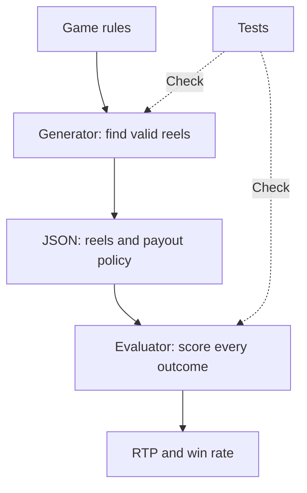
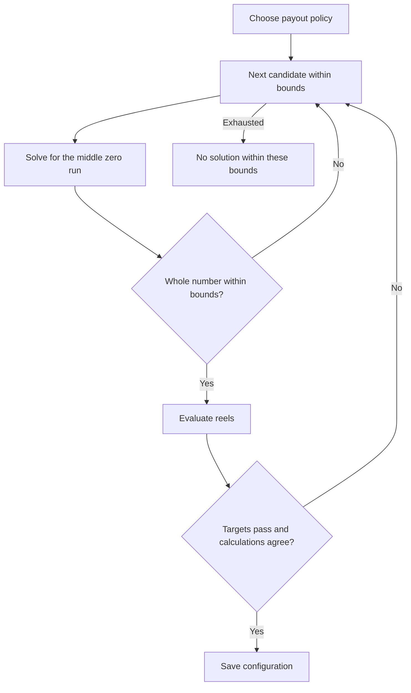
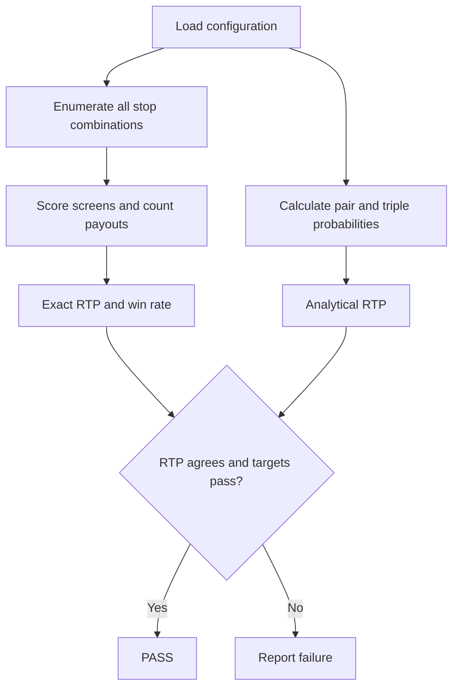

# Slot game homework

- Python -> 3.10 or newer.
- Dependencies -> standard library only.
- Requirements -> [original assignment](assignment.md).
- Numerical details -> [calculation files](docs/calculations/README.md).

```bash
python3 slot_math.py                           # Verify the main configuration
python3 slot_math.py reels_replace_blocks.json # Verify the alternative
python3 -m unittest -v                         # Run tests
python3 generate.py                           # Regenerate the main configuration
python3 generate.py --full-screen-policy replace-blocks
```

**1. How I understood the problem**

- My task -> choose reel lengths and symbol order.
- Fixed rules -> symbols, multipliers, and winning patterns.
- Target RTP -> [95% = 19/20](docs/calculations/payout-ticks.md).
- Minimum win rate -> [55% = 11/20](docs/calculations/payout-ticks.md).
- Win -> any positive payout, including payouts below the bet.

I separated the work into two parts:

- [Generator](generate.py) -> finds candidate reels.
- [Evaluator](slot_math.py) -> checks what those reels actually pay.



**2. How I modeled a spin**

- Reel -> circular list of symbols.
- Stop -> current symbol plus the next two.
- Stop probabilities -> uniform.
- Reels -> stop independently.
- Symbols within a column -> connected by reel order.
- `windows()` -> builds visible columns.
- `score_screen()` -> checks the winning patterns.

```text
Reel: [0, 0, 1, 2, 3, 4]

Stop at index 0 -> [0, 0, 1]
Stop at index 5 -> [4, 0, 0]
```

- Example: one zero block -> `100 × 0.25 = 25` payout.
- Player's net result -> `25 - 100 = -75`.
- Worked examples -> [payouts and ticks](docs/calculations/payout-ticks.md).

**3. How I handled the unclear payout rule**

| Full screen of zeros; bet = 100 | Calculation | Payout | Configuration |
| --- | --- | ---: | --- |
| Additive | `4 × 25 + 5 × 25` | 225 | [reels.json](reels.json) |
| Replace blocks | `5 × 25` | 125 | [reels_replace_blocks.json](reels_replace_blocks.json) |

- Each JSON file -> stores its payout rule.
- Other screens -> overlapping blocks still pay separately.
- Calculation -> [225, 125, and the policy difference](docs/calculations/payout-policy-change.md).

**4. Why I used runs of symbols**

- Run -> consecutive copies of one symbol.
- Run length `n` -> `n - 1` matching pairs; `n - 2` matching triples.
- Condition -> each run has at least two symbols and different neighbors.
- Pairs -> determine block probabilities.
- Triples -> determine full-screen probabilities.

```text
Run: 0 0 0 0
Pairs: 3
Triples: 2
```

- Main outer reel -> `20 + 2 + 2 + 2 + 2 = 28` stops.
- Zero-pair probability -> `(20 - 1) / 28 = 19/28`.
- Zero-triple probability -> `(20 - 2) / 28 = 18/28`.
- Full tables -> [pair and triple calculations](docs/calculations/pair-triple-counts.md).

**5. How I found the reel lengths**

- Outer reels -> `[z, 2, 2, 2, 2]`.
- Middle reel -> `[n0, n1, n2, n3, n4]`.
- I try `n1` through `n4`, then solve for `n0`.
- Search bounds -> design choices, not assignment requirements.
- Search order and chosen lengths -> [worked search example](docs/calculations/search-and-reels.md).

Main configuration, additive rule:

```text
3844 n0 - 13664 n1 - 12656 n2 - 8176 n3 - 3696 n4 = 48232
```

| Number | Separate calculation |
| ---: | --- |
| 3844 | [Coefficient of n0](docs/calculations/coefficient-3844.md) |
| -13664 | [Coefficient of n1](docs/calculations/coefficient-minus-13664.md) |
| -12656 | [Coefficient of n2](docs/calculations/coefficient-minus-12656.md) |
| -8176 | [Coefficient of n3](docs/calculations/coefficient-minus-8176.md) |
| -3696 | [Coefficient of n4](docs/calculations/coefficient-minus-3696.md) |
| 48232 | [Constant on the right](docs/calculations/constant-48232.md) |

- Full explanation -> [where the equation comes from](docs/calculations/rtp-equation.md).
- Alternative rule -> [replacement equation](docs/calculations/replacement-equation.md).
- Middle zero runs -> [why 86 and 226](docs/calculations/search-and-reels.md).



**6. How I verified the result**

- Enumeration -> scores every stop combination.
- Duplicate screens -> retain their stop counts.
- Integer ticks -> avoid payout rounding.
- `Fraction` -> keeps ratios exact.
- Analytical RTP -> separate probability calculation.
- Tests -> scoring, wraparound, overlaps, policies, and reproducibility.



| Main result | Numerical calculation |
| --- | --- |
| 91,728 outcomes | [28 × 117 × 28](docs/calculations/stop-combinations.md) |
| 1,742,832 payout ticks | [Payout counts and weighted totals](docs/calculations/payout-histograms.md) |
| Exactly 95% RTP | [1,742,832 / (20 × 91,728)](docs/calculations/rtp-results.md) |
| 64,810 winning outcomes | [Sum of positive-payout counts](docs/calculations/win-rates.md) |
| 70.65454387% win rate | [64,810 / 91,728](docs/calculations/win-rates.md) |

**7. Results**

| Payout policy | Exact RTP | Positive-payout rate | Net-profit rate |
| --- | ---: | ---: | ---: |
| Additive | [95%](docs/calculations/rtp-results.md) | [70.65%](docs/calculations/win-rates.md) | [31.83%](docs/calculations/profit-rates.md) |
| Replacement | [95%](docs/calculations/rtp-results.md) | [92.18%](docs/calculations/win-rates.md) | [62.98%](docs/calculations/profit-rates.md) |

- Both -> pass when a win means positive payout.
- Replacement -> also exceeds 55% when a win means net profit.
- Decimal rate displays -> rounded; checks use exact fractions.

**8. Questions I would expect**

- **Why not simulate?** Sampling gives an estimate. Enumeration gives an exact result.
- **Why add overlapping payouts?** Expectation is linear. For win rate, I count each winning stop combination once.
- **Why the middle reel?** Every pattern uses it. Fixing the outer reels makes its run lengths easier to solve.
- **Any blanks?** No. Only the five specified symbols.
- **Why identical outer reels?** Fewer search variables. Their stops remain independent.
- **Fewest possible stops?** No. First valid answer within the chosen bounds.
- **Main weakness?** Repetitive zero runs. Full-screen zeros occur on [27/91 = 29.67%](docs/calculations/full-screen-frequency.md) of main-configuration spins.
- **Possible improvement?** Shorter zero runs and more varied arrangements. Recalculate RTP and win rate afterward.
- **Different full-screen rule?** The main reels give [65.3297%](docs/calculations/payout-policy-change.md) under replacement. The alternate reels restore 95%.
- **Win means profit?** Main: [31.83%](docs/calculations/profit-rates.md). Replacement: [62.98%](docs/calculations/profit-rates.md). Confirm the intended rules.
- **Could both checks share a bug?** Yes. They share the model and window helper. I also test hand-checkable cases.
- **Larger reels?** Group identical columns and retain their multiplicities. Current code enumerates directly.
- **Why no ML?** Fully specified rules. An equation and bounded search are enough.
- **No search result?** Expand the bounds or change the run structure. It does not prove impossibility.
