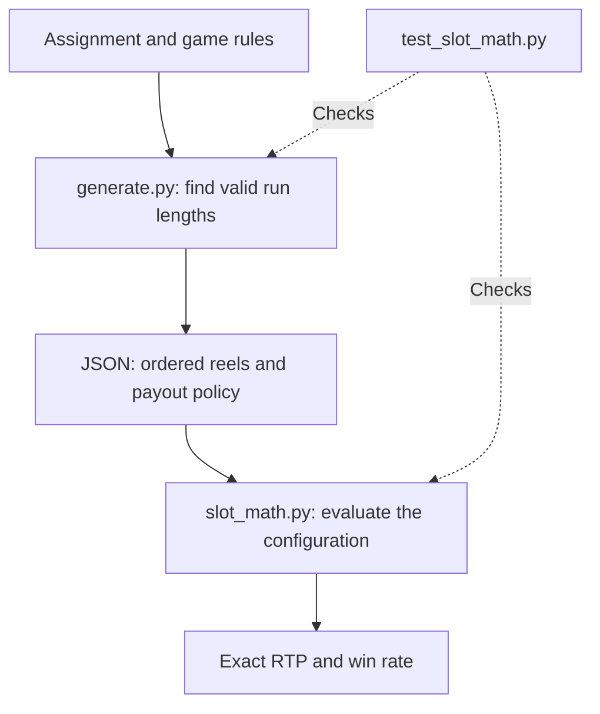
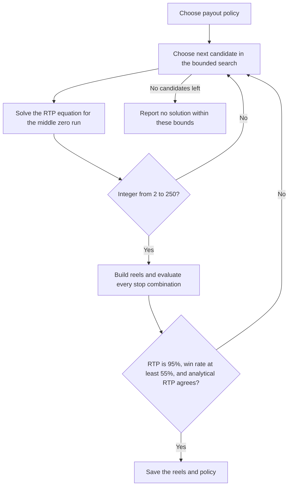
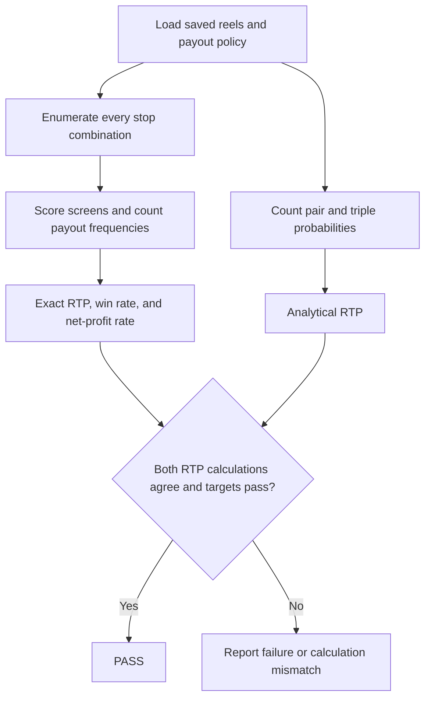

# Solution walkthrough

**1. How I understood the problem**

I treated this as a probability problem with two constraints: RTP must be
exactly 95%, and at least 55% of spins must produce a payout.

The symbols, multipliers, and winning patterns are fixed. I can change the
length of each reel and the order of its symbols.

I separated the work into a generator and an evaluator. The generator finds
candidate reels. The evaluator checks what those reels actually pay.



**2. How I modeled a spin**

Each reel is a circular list. A stop shows that position and the next two
symbols. For example:

```text
Reel: [0, 0, 1, 2, 3, 4]

Stop at index 0 -> [0, 0, 1]
Stop at index 5 -> [4, 0, 0]
```

Every position is equally likely, and the three reels stop independently.
The symbols within a column are linked by the reel arrangement, so I don't
treat the nine cells as independent draws.

In the code, `windows()` builds the visible columns and `score_screen()`
checks the four blocks and the full-screen pattern.

For this screen, only the upper-left block wins:

```text
0  0  3
0  0  4
1  2  3
```

With a bet of 100, that block pays `100 × 0.25 = 25`.
It counts as a positive payout, but it is a net loss of 75.
I report payout frequency and net-profit frequency separately.

**3. How I handled the unclear rule**

The assignment doesn't say whether a full screen also pays its four matching
blocks. I supported both interpretations:

```text
Full screen of zeros, bet = 100

Additive:      4 × 25 + 5 × 25 = 225
Replacement:           5 × 25 = 125
```

`reels.json` uses additive payouts. `reels_replace_blocks.json` uses replacement
payouts. Each file stores its rule, so the verifier selects it automatically.
Matching blocks still pay separately under both policies on other screens.

**4. Why I used runs of symbols**

A block win needs matching adjacent symbols on neighboring reels. Grouping
symbols into runs makes those matches easy to count.

```text
Run: 0 0 0 0

Matching pairs:   3
Matching triples: 2
```

A run of length `n`, surrounded by different symbols, has `n - 1` matching
pairs and `n - 2` matching triples.

For the main outer reels, the run lengths are `[20, 2, 2, 2, 2]`, giving
28 positions. The zero-pair probability is `19/28`, and the zero-triple
probability is `18/28`.

A zero block on the left needs a zero pair on both the left and middle reels.
Because their stops are independent, I multiply those pair probabilities.
Multiplying by the payout gives that event's expected contribution.

I add the expected contributions of all symbols and patterns to get RTP.

**5. How I found the reel lengths**

I searched a limited family of reels:

```text
Outer run lengths:  [z, 2, 2, 2, 2]
Middle run lengths: [n0, n1, n2, n3, n4]
```

For each outer configuration, I try lengths for symbols 1 through 4 in the
middle reel, then solve the RTP equation for the zero run.

For the main outer reels, setting RTP to `19/20` gives:

```text
3844 n0 - 13664 n1 - 12656 n2 - 8176 n3 - 3696 n4 = 48232
```

The coefficients come from the pair counts, triple counts, and payouts.
Once the other four lengths are chosen, `n0` follows directly.



The search tries outer zero runs from 20 to 60 and middle runs from 2 to 15
for the other symbols. It returns the first valid answer and is reproducible.

The main result, expressed as run lengths, is:

```text
Left:   [20, 2, 2,  2, 2]
Middle: [86, 2, 9, 15, 5]
Right:  [20, 2, 2,  2, 2]
```

**6. How I verified the result**

The main reels have `28 × 117 × 28 = 91,728` equally likely stop combinations.
I score all of them, including repeated screens produced by different stops.

I use integer payout ticks, where one tick is `bet / 20`. The multiplier
`0.55`, for example, becomes exactly 11 ticks. Ratios use Python's `Fraction`.



For the main configuration:

```text
Winning outcomes = 64,810
Win rate = 64,810 / 91,728 = 70.65454387%

Total payout ticks = 1,742,832
RTP = 1,742,832 / (20 × 91,728) = 19/20 exactly
```

The analytical calculation agrees. All 11 tests pass, covering scoring,
wraparound, overlaps, policy selection, and regeneration of both configurations.

**7. Results**

| Payout policy | Exact RTP | Positive-payout rate | Net-profit rate |
| --- | ---: | ---: | ---: |
| Additive | 95% | 70.65% | 31.83% |
| Replacement | 95% | 92.18% | 62.98% |

Both configurations meet the positive-payout definition of win rate.
The replacement configuration also exceeds 55% under the net-profit definition.

**8. Questions I would expect**

- **Why not just simulate?** Simulation estimates RTP with sampling error.
  These reels are small enough to count every outcome and prove the result
  is exactly `19/20`.

- **Patterns overlap. Why can you add their payouts?** Expectation is linear,
  even when the events are dependent. For win rate, I count each stop combination
  once if its total payout is positive.

- **Why focus on the middle reel?** Every winning pattern uses it. Once the
  outer reels are fixed, solving for its run lengths gives a simple RTP equation.
  I don't use blanks; the reels contain only the five specified symbols.

- **Why are the outer reels identical?** It reduces the search variables and
  simplifies the equation. Their stopping positions remain independent.

- **Did you find the fewest possible stops?** No. I return the first valid
  result in a bounded search. The main configuration has only 91,728 stop
  combinations, which makes exhaustive checking practical.

- **What is the main weakness?** Long zero runs make the game repetitive.
  In the main configuration, a full screen of zeros occurs on `27/91`, or about
  29.67%, of spins. Only symbol 0 can fill the full screen. For a more varied
  game, I would try shorter zero runs and more symbol arrangements, then solve
  and verify the constraints again. Splitting runs into `0 0` pairs removes
  zero triples but also changes RTP and win rate; it is not a free fix.

- **What if the full-screen rule means something else?** Applying replacement
  payouts to the main reels gives 65.3297% RTP. I provide a separately generated
  replacement configuration that restores exactly 95% RTP.

- **What if a win means profit?** The main configuration then misses the target
  at 31.83%. The replacement configuration reaches 62.98%. I would confirm both
  the payout rule and the win definition before choosing the final configuration.

- **Why use integers and fractions?** They make the RTP comparison exact.
  Decimal percentages are only used for display.

- **Do matching calculations prove the whole program is correct?** They check
  the result in two ways, but both use the same model and window helper. I also
  test hand-checkable screens and wraparound cases. The proof remains conditional
  on the stated game rules.

- **What if the reels become much larger?** Direct enumeration takes
  `O(L_left × L_middle × L_right)` time. I could group identical visible columns
  and weight them by their stop counts to reduce repeated work without losing
  exactness. The current verifier uses direct enumeration.

- **Why no machine learning?** The rules and probabilities are fully specified.
  An equation and a bounded search are enough to find and verify a valid answer.

- **What if the search finds nothing?** That only means this family and these
  bounds produced no solution. I would expand the bounds or change the run
  structure; it would not prove the assignment impossible.
